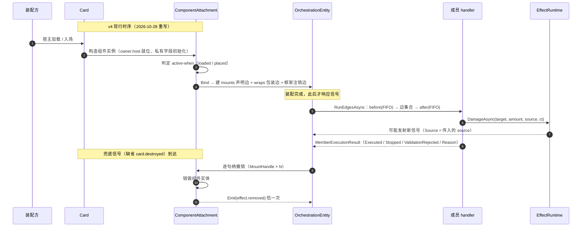

# 01 效果原理

> **本章解决什么**：讲清效果从「写下来」到「跑起来」再到「销毁」的完整因果链，并给出「不生效」的排查树——你能沿着链找到断点，而不是靠猜。
> **前置**：00（两条路径与五段模型）。本章假设你已知道 `*.card.json` 与 `*.prefab.json` 的形态。
> **读完你能做什么**：①复述装载四步并指出效果停在哪一步；②区分 `card.destroyed`（引擎销毁）与 `card.died`（游戏层死亡）；③用 8 分支排查树定位一次「没触发」。
> **对应代码路径（2026-10-28 核对）**：`Orc.Core.Model.OrchestrationEntity`（`RunEdgesAsync`/`MemberExecutionScope`）、`Orc.Core.Model.ComponentAssembly`（`ComponentAttachment`）、`Orc.Core.Model.Prefabs`（`PrefabDefinition`/`PrefabCatalog.Build`）、`Orc.Cards.Card`（薄容器）、`Orc.Game.Cards.LegacySnapshotComponentBinder`、`Orc.Game.Effects.EffectRuntime`。
> **本章自检**：能说出自动注销边的三个内建职责；能画出 v4 端到端时序；能把一个「没触发」案例定位到排查树的唯一分支。

> **⚠ 本章 §1／§2 的机制描述已退役（2026-10-28 核对）**
>
> 本章 §1 五段因果与 §2 时序图按**旧模型**写成，所依赖的类型**已从代码库删除**（git 状态 `D`）：
> `Orc.Cards.Effect`、`Effect.ExecuteMount`/`ExecuteDispose`/`Inject`、`CardLoadout.MountEffect`/`DisposeEffect`、
> `Orc.Core.Bus`、`Trigger<TView>`、`PassiveEffect`。上面 §1／§2 保留为**历史存档**，已按 v4 重写的部分见页内标注。
>
> **本章仍然有效、可以照用**：
> - §3 `card.destroyed` 与 `card.died` 的区分（层／发射点／载荷差异全部未变）；
> - §4「装载≠触发」「注册≠生效」两条判据；
> - §5 排查树的 **8 个分支划分与判定思路**（只是分支 1／3 的观察点要换成新符号，见各分支中的标注）。
>
> **作者侧写法不受影响**：旧 `*.prefab.json` 与内联 `effects.inline` 仍可装载执行，路径是
> `EffectSnapshot` → `LegacySnapshotComponentBinder` → `AssetSchemaMigrator.Migrate` → v4 组件 → 统一装配。
> 旧→新术语映射见 [09-新编排模型与术语迁移](./09-新编排模型与术语迁移.md)。

## 状态

- 章节状态：**草稿**
- 最近一次证据运行：—（本章为原理章，文内无独立命令；结论以符号与调用链为证）

---

## 1. 五段因果：谁调用谁

### ① 装载（装配）

> **v4 现行**（2026-10-28 重写）。旧 `Card.AddEffect → CardLoadout.MountEffect → Effect.ExecuteMount → OnMount` 已随 `Effect` 删除。

| 问题 | 答案 |
| --- | --- |
| 谁触发 | 宿主加载 / 入场时按组件声明的 `active-when` 装配（`loaded`＝在手即生效，`placed`＝入场后，缺省 `placed`） |
| 调用链 | 宿主基础构造 → **构造** `ComponentAttachment`（填 `owner.host`、初始化私有字段）→ 判定 `active-when` → **装配** `OrchestrationRuntime.Bind`（建 `mounts` 声明边 ＋ `wraps` 包装边 ＋ 框架注销边） |
| 断点观察点 | `ComponentAttachment.IsAssembled`（装配前不响应任何信号——边还没建）；`IsDisposed`；`PrefabType.Chain`（继承链根→叶子） |
| 失败语义 | 装载期失败（结构/寻址/可见性/通道/时机/视图/csx 编译）＝**拒绝装载**，不再是"隔离记录后继续"；卡包原子，任一资产失败＝整包零注册 |

> 顺序不可换：**构造先于装配**，私有字段在构造期就位、`owner.host` 从此可用；装配才建立边。
> **复装＝重建实例**（销毁后再入场新建实例、私有字段复位），不存在"复用实例重跑初始化"。
> **同一组件预制体在同一宿主上至多一份实例**（需要两份＝两个不同预制体）。

### ② 触发（Dispatch）

> **v4 现行**（2026-10-28 重写）。旧 `Bus` → `Trigger<TView>.InvokeAsync` → `RunEventsAsync`（`SortKey`）已随 `Bus`/`Trigger<TView>` 删除。

| 问题 | 答案 |
| --- | --- |
| 谁触发 | `LogicEngine` 发射信号 → 该信号上已装配的成员边集合 |
| 调用链 | 信号端点 → `OrchestrationEntity.RunEdgesAsync`：包装 `before`（FIFO）→ 边集合（`first`：自有边→外来边；`last`：外来边→自有边）→ 包装 `after`（FIFO） |
| 断点观察点 | 成员是否在 `mounts` 里挂了目标信号；`ComponentAttachment.IsAssembled`；`MemberExecutionScope.Stopped`；执行后的 `MemberExecutionResult`（`Executed`/`Stopped`/`ValidationRejected`/`Reason`） |
| 失败语义 | 合法性检验拒绝＝`MemberExecutionResult.Rejected(reason)`，只取消本次、不传播；handler 异常＝隔离记录，不中断其余单元 |

### ③ 结算（Handler）

| 问题 | 答案 |
| --- | --- |
| 谁触发 | 边集合执行到该单元 |
| 调用链 | `handler(view, ctx, ct)` → 读视图/`ctx` → 调受控动作面 |
| 断点观察点 | 视图属性值（`Source`/`TriggerCard`/载荷键）；动作面返回值（`false`/`0`/结果对象）；`owner.<私有字段>`（影子状态，不进数据面） |
| 失败语义 | 动作面返回 `false`/`0`＝「不可用/未执行」，**不抛**；参数非法＝`ArgumentNullException`/`ArgumentException`；状态非法（如已死亡卡撤销词条）＝异常透传 |

### ④ 传播（Propagation）

| 问题 | 答案 |
| --- | --- |
| 谁触发 | 修饰器写入（`Modifiers.AddModifierAsync` / `AddModifiersAsync`） |
| 调用链 | 修饰变更 → 修饰机制集中重跑 → 有变化才发 `card.stat.changed`（`Card` + `ChangedFields`）→ 订阅者响应（守护维护、归零检查、你的效果） |
| 断点观察点 | `card.stat.changed` 是否发、`ChangedFields` 内容；`Modifiers.GetEffectiveValue(field)`（读有效值） |
| 失败语义 | 无变化＝零发射（`card.stat.changed` 是「有变更才发」）；不要在效果里手改攻防字段——绕过修饰链会导致守护/归零看不到 |

### ⑤ 销毁（卸载）

> **v4 现行**（2026-10-28 重写）。旧 `Effect.ExecuteDispose` / `Bus.UnmountOwner` / `OnUnmount` / teardown 登记已随 `Effect` 删除。

| 问题 | 答案 |
| --- | --- |
| 谁触发 | 兜底信号（缺省 `card.destroyed`；可由组件 `disposal-signal` 另行声明）上的**框架注销边** |
| 调用链 | 触发注销边 → **逐句柄撤销**该实例创建过的每条边（声明边／包装边／注销边各一份 `MountHandle`）→ 销毁组件实体 → 恰一次 `effect.removed` |
| 断点观察点 | `ComponentAttachment.IsDisposed`；`effect.removed` 是否恰一次 |
| 失败语义 | 卸载期内异常＝隔离记录、继续完成撤销；重复卸载＝空转（不抛、不重发） |

> 两处作者可见的变化：
> 1. **没有 `OnUnmount` 可写**——撤销由框架按句柄完成，不需要（也不存在）"按 owner 扫表"的清理路径；
> 2. `disposal-signal` 声明为 `effect.removed` ＝**装载期拒绝**（防自触发递归）。

## 2. 端到端时序



## 3. `card.destroyed` 与 `card.died`

名字近似、**语义不同**，别混用：

| 维度 | `card.destroyed`（`Updates.CardDestroyed`） | `card.died`（`GameUpdates.CardDied`） |
| --- | --- | --- |
| 层 | 内核 | 游戏层 |
| 含义 | 引擎**销毁**（生命周期终止＋装载链清理驱动） | 游戏层**死亡**（战斗/效果致死，数值链判定） |
| 发射点 | `LogicEngine.DestroyCard`（`Card` 销毁） | `CommandManager.ProcessDeathAsync` 末步（清理就绪后） |
| 载荷 | `{ Card }` | `{ Card, Killer, Source }`（`Killer` 可为 null；`Source`＝击杀者） |
| 触发者 | 无 `Source` 键（内核） | `Source`＝击杀者（无击杀者时 null） |
| 是否发 `unit.position.changed` | 否 | 否（死亡不发位置信号；槽位已释放） |
| 典型用途 | 清理兜底（框架注销边缺省的兜底信号） | 「亡计」「被消灭时」「本单位消灭敌方时」 |
| 与效果的关系 | 销毁**不是**效果语义，是容器清理 | 死亡**是**规则语义；此时效果仍装载（先 `card.died` 还是先卸载取决于流程顺序） |

> 判断口诀：**「我的卡被规则打死了吗」→ `card.died`；「我的卡对象被引擎清了」→ `card.destroyed`。**
> 两者可能前后脚发生，但监听 `card.destroyed` 做「亡计」会把「手牌弃置/销毁」也算进去——这是最常见的误用。

## 4. 「装载≠触发」「注册≠生效」

- **装载≠触发**：装配完成只说明边已建立。若 `mounts[].target` 指向的信号从不发射（地址写错、该动作在当前层不存在），handler 永远不执行。
  观察：该信号上有没有你的成员边；事件流里有没有该信号。
- **注册≠生效**：注册只说明进了事件表。是否执行取决于：band 是否匹配方案、优先级是否被前序 `Stop/Interrupt` 截断、注册者/归属过滤是否放行、handler 内条件是否 return。
  观察：`trigger.Events` 的顺序；`ctx.Stopped`/`ctx.Interrupted`；`view.Source`/`view.TriggerCard`/`view.Host` 的实际值。

## 5. 排查树（8 分支，逐条可独立判定）

```mermaid
flowchart TD
    A[效果没有任何反应] --> B{1 装载成功?}
    B -- 否 --> B1[查装载期报告（结构/寻址/可见性/时机/视图/compile）/ active-when 是否命中]
    B -- 是 --> C{2 信号发了吗?}
    C -- 否 --> C1[查 mounts[].target 是否写对信号地址 engine#X / 该动作是否真的发生]
    C -- 是 --> D{3 成员被选中了吗?}
    D -- 否 --> D1[查边集合位次 OwnEdgePosition / 是否被 Stop 或 Interrupt]
    D -- 是 --> E{4 归属过滤过了吗?}
    E -- 否 --> E1[查 view.Source / view.TriggerCard / view.Host]
    E -- 是 --> F{5 条件分支 return 了吗?}
    F -- 是 --> F1[加日志确认分支输入（数量/归属/状态）]
    F -- 否 --> G{6 动作面执行了吗?}
    G -- 否 --> G1[查返回值 false/0 与失败语义（服务不可达/目标非法）]
    G -- 是 --> H{7 效果还在吗?}
    H -- 否 --> H1[查 effect.removed / IsDisposed / 卡是否已离场或被销毁]
    H -- 是 --> I{8 变化真的发生了吗?}
    I -- 否 --> I1[读 Modifiers.GetEffectiveValue；无变化不发 card.stat.changed]
    I -- 是 --> Z[链路成立：按预期工作]
```

| # | 分支 | 独立判定方法 | 常见修法 |
| --- | --- | --- | --- |
| 1 | 装载失败 | `ComponentAttachment.IsAssembled == false`；装载期报告里的失败分类（`structure`/`addressing`/`visibility`/`channel`/`timing`/`view`/`compile`） | 按报告里的地址与成员名改声明；`active-when` 与宿主时点对齐 |
| 2 | 信号没发 | 成员的 `mounts[].target` 是否命中真实信号地址；事件流里有没有该信号 | 改成 `engine#<真实信号>`（见 [信号表](./reference/信号表.md)）；确认动作真的发生 |
| 3 | 未被选中/被截断 | 边集合位次（`OwnEdgePosition`：`first`/`last`）；前序单元调用了 `ctx.Stop()` | 调成员位次或 `priority`；不要在共享链上无条件下 `Stop` |
| 4 | 归属过滤挡住 | 打印 `view.Source`、`view.TriggerCard`、`view.Host` | 用 `Host` 判自身；用 `Source` 判引发者（别用 `TriggerCard` 代替） |
| 5 | 条件 return | 在 if 前后加日志 | 修正条件；把「不满足」显式记录 |
| 6 | 动作面未执行 | 看返回值与 `DeckFetchResult`/`VeteranPromotionResult` | 服务不可达＝脱局/未装配；目标非法＝换目标 |
| 7 | 效果已卸载 | `effect.removed` 信号；`ComponentAttachment.IsDisposed` | 不要在销毁后继续调度；撤销由框架逐句柄完成，**没有 `OnUnmount` 可写** |
| 8 | 变化未传播 | `Modifiers.GetEffectiveValue(field)` 前后对比 | 用修饰/光环，不直接改字段 |

> **「来源为空」分支**：若第 4 步发现 `view.Source == null`，先查**发射方是否传了 `source`**——`Source` 恒写但可空，不是所有信号都已下沉 source（现状见 [信号表](./reference/信号表.md) §7）。此时改用载荷里已有的对象键（如 `unit.damage.dealt.Unit`）或 `view.TriggerCard`。

## 6. 最小片段（代码侧）：本单位部署后造成 1 点伤害

> **本节已按 v4 重写（2026-10-28）**。旧写法 `class XxxEffect : PassiveEffect` + `OnMount` + `Inject(trigger, 缝名, band)` **整类已删**，
> `AttackFlowBands`／`DamageFlowBands` 枚举也已不存在。

代码侧现在有两条路：

| 路径 | 适用 | 入口 |
| --- | --- | --- |
| **直连信号**（无预制体） | 引擎内部/装配期注册，不需要被资产引用 | `engine.SubscribeMember(signal, displayName, owner, edge, priority)` |
| **声明预制体**（可被资产/卡包引用） | 给卡牌用的效果组件 | `new PrefabDefinition(...)` 注册进 `PrefabCatalog` |

直连信号的最小片段（处理器仍是强类型视图，视图从**同一份 `ctx` 数据面**绑定，执行完即封）：

```csharp
using Orc.Core;
using Orc.Core.Model;
using Orc.Game;
using Orc.Game.Effects;

// 本单位部署后，对敌方一个单位造成 1 点伤害。
engine.SubscribeMember(
    GameUpdates.UnitDeployed,          // 信号名（"unit.deployed"）
    "部署追击伤害",                     // 成员显示名（留痕用）
    owner: this,                       // 归属（撤销/审计用，不是归因）
    MemberEdges.For<CardEventView>(OnDeployed));   // 把强类型处理器接成一条自有边

async Task OnDeployed(CardEventView view, Context ctx, CancellationToken ct)
{
    // 只响应自己部署（载荷键是 Unit，不是 Card）
    if (view.Unit is not Orc.Cards.Card unit)
    {
        return;
    }

    if (!ReferenceEquals(unit, view.Host))
    {
        return;
    }

    if (EffectRuntime.ResolveFor(unit) is not { } runtime)
    {
        return; // 脱局/未装配：降级不抛
    }

    var targets = await runtime.SelectAsync(unit, new EffectSelector("one", "enemy"));
    foreach (var target in targets)
    {
        await runtime.DamageAsync(target, 1, unit, ct);
    }
}
```

要点：

- **没有 `Inject`、没有 `OnMount`、没有 `OnUnmount`**：挂载＝声明一条边，撤销＝框架按句柄完成。
- `MemberEdges.For<TView>` 不是兼容桥——视图绑定器从来是内核公共件，它只是把「处理器」与「边」两种形态对上。
- 要**改写**既有流程（旧 `Inject(..., band, ...)` 的场景）改用 `wraps` 声明：`{ "target": "engine#damage-apply", "phase": "before" }`，
  判定器侧用 `judge-wraps`。可用目标见 `Orc.Game.Model.EngineProcesses.InjectTargets`（旧显示名 → 新成员地址的官方映射表）。
- `DamageAsync(target, amount, source, ct)` 的 `source` 在 `ct` 之前（既有形参），会写入下游信号并作击杀者归因。

## 7. 本章自检

- [ ] 能按顺序说出装载四步（构造 → 判定 `active-when` → 装配 `Bind` → 之后才响应信号）
- [ ] 能说清「装配前不响应任何信号」的原因（边还没建）
- [ ] 能说清 `card.destroyed` 与 `card.died` 的层、发射点、载荷差异
- [ ] 能对「没触发」案例在排查树中定位唯一分支，并说出该分支的判定方法
- [ ] 能解释「`Source` 为空」是发射方未传，而非 handler 写错
