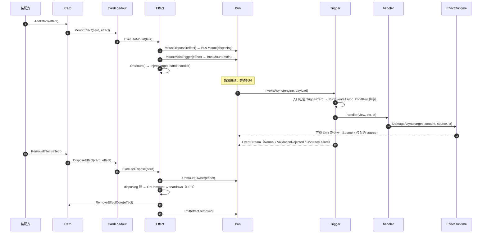
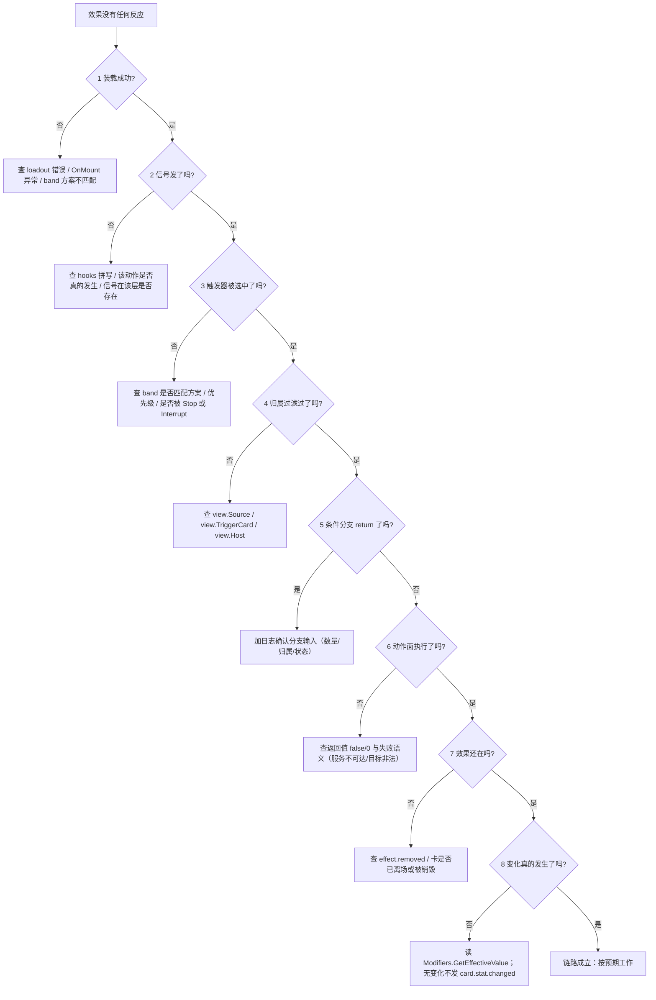

# 01 效果原理

> **本章解决什么**：讲清效果从「写下来」到「跑起来」再到「销毁」的完整因果链，并给出「不生效」的排查树——你能沿着链找到断点，而不是靠猜。
> **前置**：00（两条路径与五段模型）。本章假设你已知道 `*.card.json` 与 `*.prefab.json` 的形态。
> **读完你能做什么**：①复述装载四步并指出效果停在哪一步；②区分 `card.destroyed`（引擎销毁）与 `card.died`（游戏层死亡）；③用 8 分支排查树定位一次「没触发」。
> **对应代码路径**：`Orc.Cards.Card`、`Orc.Cards.CardLoadout`（`MountEffect`/`DisposeEffect`）、`Orc.Cards.Effect`（`ExecuteMount`/`ExecuteDispose`/`Inject`）、`Orc.Core.Trigger`（`InvokeAsync`/`RunEventsAsync`）、`Orc.Core.Bus`（`Mount`/`UnmountOwner`）、`Orc.Game.Effects.EffectRuntime`。
> **本章自检**：能说出 disposing 触发器的三个内建事件；能画出端到端时序；能把一个「没触发」案例定位到排查树的唯一分支。

## 状态

- 章节状态：**草稿**
- 最近一次证据运行：—（本章为原理章，文内无独立命令；结论以符号与调用链为证）

---

## 1. 五段因果：谁调用谁

### ① 装载（Loadout）

| 问题 | 答案 |
| --- | --- |
| 谁触发 | `Card.AddEffect` / `Card.MountPassiveEffects` / `card.placed` 处理器（三入口） |
| 调用链 | `Card.AddEffect` → `CardLoadout.MountEffect(card, effect)` → `Effect.ExecuteMount(bus)` → `MountDisposal` → `MountMainTrigger` → `OnMount()` → `LogicEngine.RunCardMountCompletedActions` |
| 断点观察点 | `Effect.IsMounted`；装载失败会在事件流留下 `source=loadout` 的错误条目（`CardsLog.Write`） |
| 失败语义 | `OnMount` 抛异常 → 回滚装载（撤销注入、卸载、清 teardown 登记），**记录但不阻断**宿主与其它效果 |

> `ExecuteMount` 的顺序不可换：先挂 disposing（保证失败也能清理），再挂主触发器，最后 `OnMount` 才允许 `Inject`（`Inject` 在非装载语境会抛 `InvalidOperationException`）。

### ② 触发（Dispatch）

| 问题 | 答案 |
| --- | --- |
| 谁触发 | 总线：`LogicEngine.Emit(updateType, payload)` → 该 hook 的订阅者 |
| 调用链 | `Bus` → `Trigger<TView>.InvokeAsync(engine, data)` → 入口初值（`TriggerCard`）→ `RunEventsAsync` → 按 `EventEntry.SortKey` 排序逐个执行 |
| 断点观察点 | `trigger.Events`（执行序快照）；`Bus.GetSubscribers(hook)`（是否挂上）；执行帧的 `TriggerCard` |
| 失败语义 | **入口载荷错形态**（`TriggerCard` 键不是 `Card`）＝立即抛 `InvalidCastException`；**handler 异常**＝记录 `exception:<类型>` 并继续下一个事件（不中断整条链） |

### ③ 结算（Handler）

| 问题 | 答案 |
| --- | --- |
| 谁触发 | 触发器选中该注册项 |
| 调用链 | `handler(view, ctx, ct)` → 读视图/`ctx` → 调受控动作面 |
| 断点观察点 | 视图属性值（`Source`/`TriggerCard`/载荷键）；动作面返回值（`false`/`0`/结果对象） |
| 失败语义 | 动作面返回 `false`/`0`＝「不可用/未执行」，**不抛**；参数非法＝`ArgumentNullException`/`ArgumentException`；状态非法（如已死亡卡撤销词条）＝异常透传 |

### ④ 传播（Propagation）

| 问题 | 答案 |
| --- | --- |
| 谁触发 | 修饰器写入（`Modifiers.AddModifierAsync` / `AddModifiersAsync`） |
| 调用链 | 修饰变更 → 修饰机制集中重跑 → 有变化才发 `card.stat.changed`（`Card` + `ChangedFields`）→ 订阅者响应（守护维护、归零检查、你的效果） |
| 断点观察点 | `card.stat.changed` 是否发、`ChangedFields` 内容；`Modifiers.GetEffectiveValue(field)`（读有效值） |
| 失败语义 | 无变化＝零发射（`card.stat.changed` 是「有变更才发」）；不要在效果里手改攻防字段——绕过修饰链会导致守护/归零看不到 |

### ⑤ 销毁（Dispose）

| 问题 | 答案 |
| --- | --- |
| 谁触发 | `Card.RemoveEffect`（显式）／`card.destroyed` 兜底／`effect.removed` 信号兜底 |
| 调用链 | `CardLoadout.DisposeEffect` → `Effect.ExecuteDispose`：停用（`Bus.UnmountOwner`＋撤销注入）→ disposing 事件链（守卫 → 兜底驱动 → `OnUnmount`）→ teardown 登记（LIFO）→ 容器移除 → 恰一次 `effect.removed` |
| 断点观察点 | `Effect.DisposalState`（`NotMounted/Mounted/Disposing/Disposed`）；`effect.removed` 是否恰一次 |
| 失败语义 | disposing 内异常＝隔离记录、继续完成销毁链；重复销毁＝空转（不抛、不重发） |

## 2. 端到端时序



## 3. `card.destroyed` 与 `card.died`

名字近似、**语义不同**，别混用：

| 维度 | `card.destroyed`（`Updates.CardDestroyed`） | `card.died`（`GameUpdates.CardDied`） |
| --- | --- | --- |
| 层 | 内核 | 游戏层 |
| 含义 | 引擎**销毁**（生命周期终止＋装载链清理驱动） | 游戏层**死亡**（战斗/效果致死，数值链判定） |
| 发射点 | `LogicEngine.DestroyCard`（`Card` 销毁） | `CommandManager.ProcessDeathAsync` 末步（清理就绪后） |
| 载荷 | `{ Card }` | `{ Card, Killer, Source }`（`Killer` 可为 null；`Source`＝击杀者） |
| 触发者 | 无 `Source` 键（内核） | `Source`＝击杀者（无击杀者时 null） |
| 是否发 `unit.position.changed` | 否 | 否（死亡不发位置信号；槽位已释放） |
| 典型用途 | 清理兜底（disposing 默认 hooks 强制包含它） | 「亡计」「被消灭时」「本单位消灭敌方时」 |
| 与效果的关系 | 销毁**不是**效果语义，是容器清理 | 死亡**是**规则语义；此时效果仍装载（先 `card.died` 还是先卸载取决于流程顺序） |

> 判断口诀：**「我的卡被规则打死了吗」→ `card.died`；「我的卡对象被引擎清了」→ `card.destroyed`。**
> 两者可能前后脚发生，但监听 `card.destroyed` 做「亡计」会把「手牌弃置/销毁」也算进去——这是最常见的误用。

## 4. 「装载≠触发」「注册≠生效」

- **装载≠触发**：装载完成只说明触发器挂上了总线。若 `hooks` 写的信号从不发射（拼写、层级、时序），handler 永远不执行。
  观察：`Bus.GetSubscribers("unit.deployed")` 是否包含你的触发器显示名；事件流里有没有该信号。
- **注册≠生效**：注册只说明进了事件表。是否执行取决于：band 是否匹配方案、优先级是否被前序 `Stop/Interrupt` 截断、注册者/归属过滤是否放行、handler 内条件是否 return。
  观察：`trigger.Events` 的顺序；`ctx.Stopped`/`ctx.Interrupted`；`view.Source`/`view.TriggerCard`/`view.Host` 的实际值。

## 5. 排查树（8 分支，逐条可独立判定）



| # | 分支 | 独立判定方法 | 常见修法 |
| --- | --- | --- | --- |
| 1 | 装载失败 | `effect.IsMounted == false`；事件流有 `loadout` 错误 | 修 `OnMount` 异常；band 枚举与触发器方案对齐 |
| 2 | 信号没发 | `Bus.GetSubscribers(hook)` 不含触发器；事件流无该信号 | 改 hooks 到真实信号（见 [信号表](./reference/信号表.md)）；确认动作真的发生 |
| 3 | 未被选中/被截断 | `trigger.Events` 顺序；前置事件调用了 `ctx.Stop()` | 调 band/priority；不要在共享链上无条件下 `Stop` |
| 4 | 归属过滤挡住 | 打印 `view.Source`、`view.TriggerCard`、`view.Host` | 用 `Host` 判自身；用 `Source` 判引发者（别用 `TriggerCard` 代替） |
| 5 | 条件 return | 在 if 前后加日志 | 修正条件；把「不满足」显式记录 |
| 6 | 动作面未执行 | 看返回值与 `DeckFetchResult`/`VeteranPromotionResult` | 服务不可达＝脱局/未装配；目标非法＝换目标 |
| 7 | 效果已卸载 | `effect.removed` 事件；`card.Effects` 是否仍含该效果 | 不要在销毁后继续调度；把清理放 `OnUnmount` |
| 8 | 变化未传播 | `Modifiers.GetEffectiveValue(field)` 前后对比 | 用修饰/光环，不直接改字段 |

> **「来源为空」分支**：若第 4 步发现 `view.Source == null`，先查**发射方是否传了 `source`**——`Source` 恒写但可空，不是所有信号都已下沉 source（现状见 [信号表](./reference/信号表.md) §7）。此时改用载荷里已有的对象键（如 `unit.damage.dealt.Unit`）或 `view.TriggerCard`。

## 6. 最小片段（代码侧）：攻击结算后追加 1 点伤害

> 数据侧等价写法：hooks `unit.attacked` 不存在——攻击结算的扩展位是流程 band（`AttackFlowBands.Resolve`），**只能代码侧注入**。这是「数据侧不可达」的典型。

```csharp
using Orc.Cards;
using Orc.Core;
using Orc.Game.Effects;

/// <summary>本单位发起攻击、结算完成后，对被攻击者追加 1 点伤害。</summary>
public sealed class AttackExtraDamageEffect : PassiveEffect
{
    private readonly LogicEngine _engine;

    public AttackExtraDamageEffect(LogicEngine engine, string name = "攻击追加伤害")
        : base(name)
    {
        _engine = engine;
    }

    protected override void OnMount()
    {
        // AttackFlowBands.Resolve 的默认处理器是「伤害结算」；priority 100 排在其后。
        Inject(
            _engine.AttackFlow.Trigger,
            "结算后追加",
            AttackFlowBands.Resolve,
            OnAfterResolve,
            priority: 100);
    }

    private async Task OnAfterResolve(AttackFlowView view, Context ctx, CancellationToken ct)
    {
        // 只响应本单位发起的攻击（链上传递的触发者）
        if (!ReferenceEquals(view.Source, Host))
        {
            return;
        }

        if (EffectRuntime.ResolveFor(Host) is not { } runtime)
        {
            return; // 脱局/未装配：降级不抛
        }

        await runtime.DamageAsync(view.Target, 1, Host, ct);
    }
}
```

要点：

- `Inject` 只在 `OnMount` 语境可用（否则 `InvalidOperationException`）；撤销由框架在销毁时自动完成，**不要**在 `OnUnmount` 手写反注册。
- `view.Source` 是攻击流程视图的**非空** `Card`（流程内必有来源），与信号的 `Source` 同名但不同承载。
- `DamageAsync(target, amount, source, ct)` 的 `source` 在 `ct` 之前（既有形参），会写入下游信号并作击杀者归因。

## 7. 本章自检

- [ ] 能按顺序说出装载四步，并解释为什么 disposing 必须最先挂
- [ ] 能列出 disposing 触发器的三个内建事件（守卫 / 兜底驱动 / 效果销毁）
- [ ] 能说清 `card.destroyed` 与 `card.died` 的层、发射点、载荷差异
- [ ] 能对「没触发」案例在排查树中定位唯一分支，并说出该分支的判定方法
- [ ] 能解释「`Source` 为空」是发射方未传，而非 handler 写错
